<div align="center">


# Voka

**Type freely. Write precisely.**

An English input method for people who did not grow up writing English.<br>
Spell a word roughly, stop halfway, or get it slightly wrong — Voka finds the word you meant.

[](#install)
[](#local-ai)
[](LICENSE)

[**Install**](#install) · [Website](https://pili.sh) · [简体中文](README.zh-CN.md)

<br>



</div>

<br>

## What it does

Candidates appear while you type, each with a short meaning, and Space commits the first one.

<table>
<tr>
<td width="50%" valign="top">

**Spell it roughly**<br>
By ear, or just the consonants. Close is enough.

`nolej` → **knowledge**<br>
`bhvr` → **behavior**

</td>
<td width="50%" valign="top">

**Slips fixed on Space**<br>
Common misspellings are corrected the moment you finish the word.

`definately` → **definitely**<br>
`resturant` → **restaurant**

</td>
</tr>
<tr>
<td valign="top">

**Finish long words with Tab**<br>
Type the first few letters and take the suggestion.

`infras` <kbd>Tab</kbd> → **infrastructure**<br>
`recom` <kbd>Tab</kbd> → **recommend**

</td>
<td valign="top">

**Small grammar slips**<br>
Only when the sentence leaves no doubt.

`Yesterday he go` → **went**<br>
`a interview` → **an interview**

</td>
</tr>
<tr>
<td valign="top">

**Local AI reads the sentence**<br>
When spelling alone cannot settle it, a small language model on your Mac looks at what you wrote.

`because of the bad wether` → **weather**

</td>
<td valign="top">

**Correct text is left alone**<br>
Names, jargon, code and anything with digits or symbols stay exactly as typed.

`getUserProfile` · `--verbose` · `gpt4` · `v2`

</td>
</tr>
</table>

## Install

Download the macOS installer (`.pkg`) from the [latest release](https://github.com/pililiw/voka/releases/latest)
and open it. Or give this to your agent, which builds Voka from source:

```text
Install Voka for me: github.com/pililiw/voka
```

Either way, two clicks are yours:

1. In the Voka window that opens, click **Enable Voka** and confirm when macOS asks.
2. Pick Voka from the input menu in the menu bar. <kbd>Ctrl</kbd> <kbd>Space</kbd> switches between
   your last two input sources.

Requires macOS 13 or later, Apple silicon or Intel. To do it by hand, see
[Build from source](#build-from-source).

> Agents: follow [Build from source](#build-from-source), then ask the user to click **Enable Voka**.

<details>
<summary>If macOS does not let Voka enable itself</summary>

Add it by hand: **System Settings → Keyboard → Text Input → Edit… → +**, choose **English**, select
**Voka**, click **Add**, then **Allow**. If Voka does not show up in the input menu afterwards, log out
and back in once.

</details>

<details>
<summary>Uninstall</summary>

Remove Voka from the Text Input list, then run [`macos/scripts/uninstall.sh`](macos/scripts/uninstall.sh),
from the repository or downloaded on its own. It stops if Voka is still in the list.

</details>

## Keys

| Key | What it does |
|---|---|
| Letters | Start a word. The highlighted candidate is what Space will commit. |
| <kbd>Space</kbd>, punctuation | Commit the highlighted candidate: a correction when Voka is certain, otherwise exactly what you typed. |
| <kbd>Tab</kbd> | Take the suggestion — the first candidate that differs from what you typed — and add a space. |
| <kbd>1</kbd>–<kbd>5</kbd> | Pick the candidate with that number. A digit that belongs to what you are typing stays text: `gpt4`, `ipv6`, `mp3`. |
| <kbd>←</kbd> <kbd>→</kbd> <kbd>↑</kbd> <kbd>↓</kbd> | Move the highlight. A click or <kbd>⌥</kbd> <kbd>1</kbd>–<kbd>5</kbd> picks a candidate directly. |
| <kbd>Enter</kbd> | Keep the letters as typed, without sending the message or breaking the line. After you moved the highlight, Enter commits the highlighted candidate instead. <kbd>Shift</kbd> <kbd>Enter</kbd> keeps the letters and passes the key on. |
| <kbd>Esc</kbd> | Keep the letters as typed and close the candidates. |
| <kbd>⌫</kbd> | Delete a letter. <kbd>⌥</kbd> <kbd>⌫</kbd> discards the word being typed. |

After an automatic correction a small **Restore** button brings back what you typed.

## Local AI

Voka ships with a 17-million-parameter language model
([ettin-decoder-17m](https://huggingface.co/jhu-clsp/ettin-decoder-17m)) that runs on your Mac through
Core ML. It scores the candidates against the sentence so far, in the background, while you type.

- It can only **add** a correction for something that is not a word. It never changes a real word and
  never undoes what the engine decided.
- Typing never waits for it. On a slow or busy Mac the candidates arrive a moment later; if the model
  cannot keep up it pauses itself.
- Nothing leaves your Mac: no network, no account, no telemetry, no typing history. See
  [PRIVACY.md](PRIVACY.md).

## Settings

Open **Voka** from Applications or Spotlight, or choose **Voka Settings…** in the input menu. There
are three settings, and they apply at once:

- **Meanings** — the language of the short meaning next to each candidate. Simplified Chinese is
  available today; it is on by default when Chinese is one of your system languages.
- **Local AI** — on by default; turning it off unloads the model.
- **Number keys pick candidates** — on by default.

## How it decides

- **A correct word is never replaced by another word.** Dictionary words, names, abbreviations, and
  anything with digits, symbols, capitals inside or hyphens are kept. What may change is the form of
  a word, as described below, and its capitals: the first word of a sentence, `i` → `I`, and product
  names such as `github` → `GitHub`.
- **Space replaces only when the correction is certain.** Otherwise your letters stay and the
  suggestion waits behind Tab.
- **Word forms are corrected only when the sentence leaves no doubt**: `a`/`an`, third person
  singular, past tense with a time expression, irregular plurals after a quantifier.

Terminal applications and password fields are passed through untouched.

## Build from source

Requires the Xcode Command Line Tools (`xcode-select --install`) or Xcode, and Node 22.

```bash
npm install --omit=dev
```

```bash
npm run macos:install
```

This builds Voka and installs it for the current user. The Voka window opens the first time. Enabling
an input method takes a click and a confirmation that macOS accepts only from the person at the Mac, so
an agent stops here and hands over: click **Enable Voka** in that window.

<details>
<summary>Project layout and tests</summary>

```
src/engine/     the engine, in TypeScript: tokens, lexicon, phonetic matching, ranking, grammar, key handling
macos/          the input method: Swift, InputMethodKit; runs the engine in JavaScriptCore and the
                model in Core ML. Also the small Voka app for the Applications folder
data/           compiled dictionary and the language model
scripts/        dictionary and engine bundle builders, meanings, model conversion, README animation
eval/           behaviour spec and evaluation scripts
tests/          unit tests, model fixtures, and the parity file replayed on Node and JavaScriptCore
```

The tests and the dictionary build need the development packages as well:

```bash
npm install
```

```bash
npm test
```

```bash
npm run macos:test
```

```bash
npm run eval
```

A debug build can show the Voka window on its own: run `swift build` in `macos/`, then
`macos/.build/debug/VokaIME --preview-window` from the repository root.

</details>

See [CONTRIBUTING.md](CONTRIBUTING.md) for how to change engine behaviour.

## Limitations

- Short, ambiguous spellings by sound (`fone`, `foto`) are not replaced on Space; the intended word
  is among the candidates.
- A typed word that is itself a real word is never replaced by a different word, even when another
  word was meant.

## License

The source code is under the [MIT License](LICENSE). The dictionary (`data/dict.json`) is compiled
from third-party sources and is distributed under CC BY-SA 4.0; the language model is a third-party
model under the MIT License, and its tokenizer file is under the Apache License 2.0. Details and notices are in [THIRD_PARTY_NOTICES.md](THIRD_PARTY_NOTICES.md).

<div align="center">
<br>
<sub>Made by <a href="https://pili.sh">pili</a></sub>
</div>
