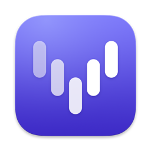

<div align="center">



# Voka

**随手打，写得准。**

给非英语母语者的英文输入法。<br>
按读音拼、只打一半、或者拼错一点——Voka 都能找到你想写的那个词。

[](#安装)
[](#本地-ai)
[](LICENSE)

[**安装**](#安装) · [官网](https://pili.sh) · [English](README.md)

<br>



</div>

<br>

## 它能做什么

边打边出候选，每个候选带简短释义，空格上屏第一个。

<table>
<tr>
<td width="50%" valign="top">

**大概拼对就行**<br>
照着读音打，或者只打辅音，都能认出来。

`nolej` → **knowledge**<br>
`bhvr` → **behavior**

</td>
<td width="50%" valign="top">

**拼错了，空格改对**<br>
常见的错拼在打完这个词的瞬间就被纠正。

`definately` → **definitely**<br>
`resturant` → **restaurant**

</td>
</tr>
<tr>
<td valign="top">

**Tab 补全长词**<br>
打开头几个字母，按 Tab 采纳建议。

`infras` <kbd>Tab</kbd> → **infrastructure**<br>
`recom` <kbd>Tab</kbd> → **recommend**

</td>
<td valign="top">

**顺手改掉基础语法**<br>
只在句子没有歧义时才改。

`Yesterday he go` → **went**<br>
`a interview` → **an interview**

</td>
</tr>
<tr>
<td valign="top">

**本地 AI 读懂整句**<br>
只看拼写定不下来时，一个在你 Mac 上运行的小型语言模型会结合上文判断。

`because of the bad wether` → **weather**

</td>
<td valign="top">

**正确的内容不动**<br>
人名、术语、代码，以及带数字或符号的输入，一律原样上屏。

`getUserProfile` · `--verbose` · `gpt4` · `v2`

</td>
</tr>
</table>

## 安装

从[最新发布](https://github.com/pililiw/voka/releases/latest)下载 macOS 安装包（`.pkg`）并打开。
或者把这句话交给你的 agent，它会从源码构建 Voka：

```text
帮我安装 Voka：github.com/pililiw/voka
```

无论哪种方式，接下来有两步需要你自己点：

1. 在打开的 Voka 窗口里点 **启用 Voka**，系统询问时确认。
2. 在菜单栏的输入法菜单里选择 Voka。<kbd>Ctrl</kbd> <kbd>空格</kbd> 可在最近用过的两个输入法之间切换。

需要 macOS 13 或更高版本，Apple 芯片或 Intel 均可。想自己动手，见[从源码构建](#从源码构建)。

> 写给 agent：按[从源码构建](#从源码构建)完成安装，然后请用户点 **启用 Voka**。

<details>
<summary>如果系统不允许 Voka 自行启用</summary>

手动添加：**系统设置 → 键盘 → 文字输入 → 编辑… → +**，选 **英语**，选中 **Voka**，点 **添加**，再点 **允许**。
之后如果输入法菜单里没有出现 Voka，注销并重新登录一次。

</details>

<details>
<summary>卸载</summary>

先在「文字输入」列表里移除 Voka，在你克隆的仓库里运行 `macos/scripts/uninstall.sh`，然后注销一次。
Voka 的三项设置可以用 `defaults delete sh.pili.inputmethod.Voka` 清除。

</details>

## 按键

| 按键 | 作用 |
|---|---|
| 字母 | 开始输入一个词。高亮的候选就是空格会上屏的词。 |
| <kbd>空格</kbd>、标点 | 上屏高亮的候选：有把握时是纠正后的词，否则就是你打的原文。 |
| <kbd>Tab</kbd> | 采纳建议（第一个和输入不同的候选），并补一个空格。 |
| <kbd>1</kbd>–<kbd>5</kbd> | 直接选对应编号的候选。属于正在输入内容的数字仍是文本：`gpt4`、`ipv6`、`mp3`。 |
| <kbd>←</kbd> <kbd>→</kbd> <kbd>↑</kbd> <kbd>↓</kbd> | 移动高亮。鼠标点击或 <kbd>⌥</kbd> <kbd>1</kbd>–<kbd>5</kbd> 直接选词。 |
| <kbd>回车</kbd> | 原样保留已输入的字母，不发送、不换行。移动过高亮之后，回车上屏高亮的候选。<kbd>Shift</kbd> <kbd>回车</kbd> 保留字母并把按键交给应用。 |
| <kbd>Esc</kbd> | 原样保留已输入的字母并关闭候选。 |
| <kbd>⌫</kbd> | 删除一个字母。<kbd>⌥</kbd> <kbd>⌫</kbd> 丢弃正在输入的词。 |

自动纠正之后会短暂出现「恢复」按钮，点一下还原成你打的原文。

## 本地 AI

Voka 内置一个 1700 万参数的语言模型（[ettin-decoder-17m](https://huggingface.co/jhu-clsp/ettin-decoder-17m)），
通过 Core ML 在你的 Mac 上运行。你打字时，它在后台结合已经写下的句子给候选打分。

- 它只能给「不是词」的输入**补上**纠正，不会改动真词，也不会撤销引擎已经做出的决定。
- 打字从不等它。机器慢或者忙的时候，候选会晚一点出现；实在跟不上时它会自己暂停。
- 所有内容都留在你的 Mac 上：不联网、不需要账号、没有遥测、不记录输入历史。见 [PRIVACY.md](PRIVACY.md)。

## 设置

从「应用程序」或 Spotlight 打开 **Voka**，或在输入法菜单里选 **Voka 设置…**。一共三项，修改后立即生效：

- **释义** — 候选词旁边简短释义的语言。目前提供简体中文；系统语言包含中文时默认开启。
- **本地 AI** — 默认开启；关闭后模型会被卸载。
- **数字键选词** — 默认开启。

## 判断原则

- **正确的词不会被换成别的词。** 词典里的词、人名、缩写，以及带数字、符号、词中大写或连字符的输入都会保留。
  可能变化的只有词形（见下）和大小写：句首单词、`i` → `I`，以及 `github` → `GitHub` 这类产品名。
- **空格只在有把握时替换。** 没把握就保留原文，建议放在 Tab 上。
- **词形只在句子没有歧义时纠正**：`a`/`an`、第三人称单数、带时间词的过去式、数量词后的不规则复数。

终端类应用和密码框不做任何处理，按键原样通过。

## 从源码构建

需要 Xcode 命令行工具（`xcode-select --install`）或 Xcode，以及 Node 22。

```bash
npm install --omit=dev
```

```bash
npm run macos:install
```

会构建 Voka 并为当前用户安装，首次运行会打开 Voka 窗口。启用输入法需要一次点击和一次系统确认，macOS 只接受坐在电脑前的人来操作，
所以 agent 到这里为止，交给你：在窗口里点 **启用 Voka**。

<details>
<summary>目录结构与测试</summary>

```
src/engine/     引擎（TypeScript）：词形分析、词典、读音匹配、排序、语法、按键处理
macos/          输入法本体：Swift + InputMethodKit，在 JavaScriptCore 里运行引擎、用 Core ML 运行模型；
                以及放在「应用程序」里的 Voka 入口
data/           编译好的词典和语言模型
scripts/        词典与引擎打包脚本、释义表、模型转换、README 动画
eval/           行为规格与评测脚本
tests/          单元测试、模型校验数据，以及在 Node 和 JavaScriptCore 上回放的一致性数据
```

跑测试和重建词典还需要开发依赖：

```bash
npm install
```

```bash
npm test
```

```bash
npm run macos:test
```

```bash
npm run eval
```

调试构建可以单独显示 Voka 窗口：先在 `macos/` 里运行 `swift build`，再在仓库根目录运行
`macos/.build/debug/VokaIME --preview-window`。

</details>

修改引擎行为的流程见 [CONTRIBUTING.md](CONTRIBUTING.md)。

## 已知限制

- 很短、有歧义的读音拼写（`fone`、`foto`）不会被空格自动替换，目标词在候选里。
- 输入本身是一个真词时，不会被换成另一个词，即使你想打的是另一个词。

## 许可

源代码采用 [MIT 许可证](LICENSE)。词典（`data/dict.json`）由第三方数据编译而成，按 CC BY-SA 4.0 分发；语言模型是第三方模型，采用 MIT 许可证，其分词器文件采用 Apache 2.0 许可证。来源和声明见 [THIRD_PARTY_NOTICES.md](THIRD_PARTY_NOTICES.md)。

<div align="center">
<br>
<sub>由 <a href="https://pili.sh">pili</a> 出品</sub>
</div>
